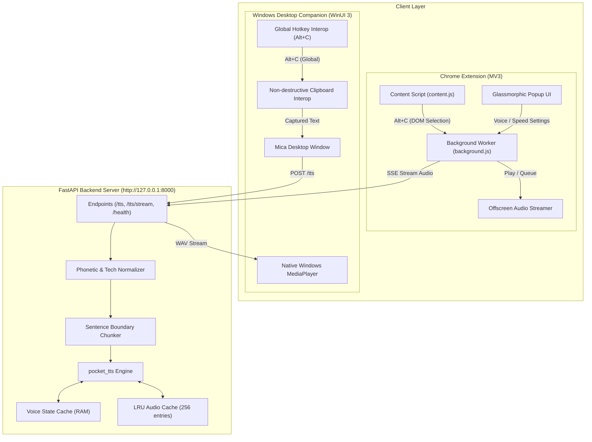

# 🎙️ Voices: Offline Neural Text-to-Speech Ecosystem

[](https://fastapi.tiangolo.com)
[](https://python.org)
[](https://developer.chrome.com/docs/extensions/mv3/)
[](https://learn.microsoft.com/windows/apps/winui/winui3/)
[](https://opensource.org/licenses/MIT)

**Voices** is a local-first, privacy-focused neural Text-to-Speech (TTS) ecosystem. It delivers high-fidelity, near-zero latency voice synthesis for highlighted text across your web browser and Windows desktop using an offline neural speech engine (`pocket_tts`).

---

## 🌟 Architecture Overview



---

## 📦 Repository Structure

```text
pocket-tts-extension/
├── manifest.json              # Chrome Manifest V3 configuration
├── background.js              # Extension service worker (SSE & state coordination)
├── content.js                 # In-page selection listener (Alt+C)
├── offscreen.html / .js       # Offscreen audio playback engine
├── popup/                     # Glassmorphic browser settings popup
│   ├── popup.html
│   ├── popup.css
│   └── popup.js
├── icons/                     # Multi-resolution extension icons
├── server/                    # Python FastAPI Neural TTS Server
│   ├── server.py              # Streaming API, cache & normalization pipeline
│   ├── pronunciation_dict.json# Custom phonetic vocabulary overrides
│   ├── requirements.txt       # Python dependencies
│   ├── run.bat                # One-click startup script
│   └── README.md              # Server documentation
├── voices-desktop/            # Windows 11 Desktop Companion (WinUI 3 / .NET 8)
│   ├── VoicesDesktop.csproj   # Project file & Windows App SDK references
│   ├── MainWindow.xaml        # Mica backdrop & dynamic 5-bar waveform UI
│   ├── MainWindow.xaml.cs     # Global hotkeys & clipboard coordination
│   ├── Services/              # Audio playback, hotkeys & clipboard interop
│   ├── run.bat                # One-click desktop build & run script
│   └── README.md              # Desktop companion documentation
├── architecture_TTS.md        # Detailed engineering specification
└── LICENSE                    # MIT License
```

---

## ⚡ Quick Start Guide

### 1. Launch the Local TTS Server

The Python server powers both the browser extension and desktop companion.

```bash
cd server
pip install -r requirements.txt
python server.py
# Or simply double-click run.bat
```
*The server will be available at `http://127.0.0.1:8000` (Healthcheck: `http://127.0.0.1:8000/health`).*

---

### 2. Load the Chrome Extension

1. Open your Chromium browser (Chrome, Edge, Brave).
2. Navigate to `chrome://extensions/`.
3. Enable **Developer mode** (top-right toggle).
4. Click **Load unpacked** and select the root `pocket-tts-extension/` directory.
5. Highlight any text on any webpage and press `Alt + C` to listen!

---

### 3. Run the Windows Desktop Companion

The desktop companion provides OS-wide reading across any desktop app (Word, PDF viewers, IDEs, Slack, etc.).

```bash
cd voices-desktop
dotnet run
# Or simply double-click run.bat
```
*Press `Alt + C` anywhere in Windows to read out loud selected text. Press `Alt + C` again while speaking to stop playback.*

---

## 🎭 Available Neural Voices

Voices provides 8 high-fidelity neural voices with zero cloud dependencies:

| Voice | Gender | Characteristic |
| :--- | :--- | :--- |
| **Alba** *(Default)* | Female | Warm, balanced, expressive narration |
| **Fantine** | Female | Soft, gentle, melodic cadence |
| **Cosette** | Female | Bright, clear, youthful |
| **Eponine** | Female | Crisp, natural, dynamic |
| **Jean** | Male | Deep, resonant, authoritative |
| **Marius** | Male | Smooth, conversational, contemporary |
| **Javert** | Male | Formal, articulate, commanding |
| **Azelma** | Female | Playful, expressive |

---

## 🛠️ Features & Highlights

- **Local-First & Private:** Audio synthesis runs completely offline on your own machine. Zero cloud telemetry.
- **SSE Low-Latency Streaming:** Sentence-level chunking streams audio segments as they finish processing, drastically reducing time-to-first-audio.
- **Phonetic Normalization Engine:** Expands tech acronyms (`TTS`, `API`, `JSON`, `SQL`), programming symbols (`C#`, `C++`), units, and versions smoothly.
- **Non-Destructive Clipboard Interop:** The desktop companion temporarily inspects highlighted text via Win32 `SendInput` and restores previous clipboard contents automatically.
- **Dynamic Waveform Visualizer:** 5-bar responsive waveform pulsing synced to speech synthesis and audio playback.

---

## 🤝 Contributing

Contributions are welcome! Please feel free to open issues or submit pull requests:

1. Fork the Project (`gh repo fork narayan-packets/pocket-tts-extension`)
2. Create your Feature Branch (`git checkout -b feature/AmazingFeature`)
3. Commit your Changes (`git commit -m 'Add some AmazingFeature'`)
4. Push to the Branch (`git push origin feature/AmazingFeature`)
5. Open a Pull Request

---

## 📄 License

Distributed under the MIT License. See [LICENSE](LICENSE) for more details.

