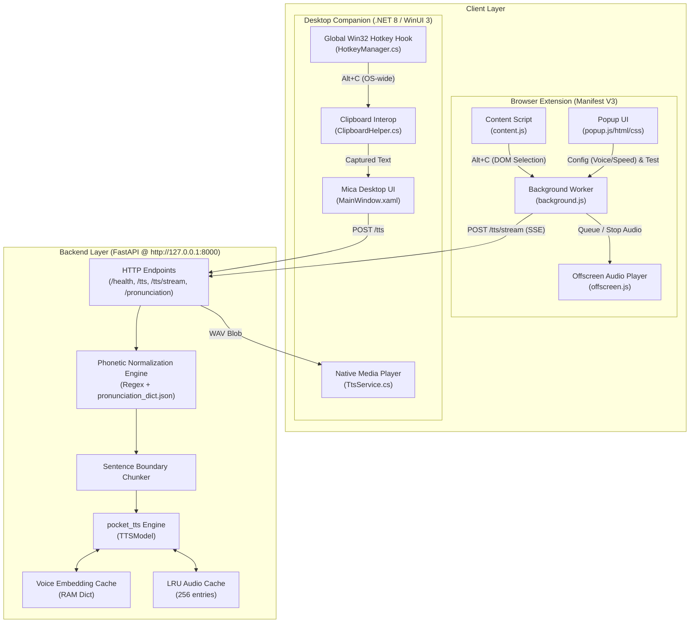

# Architecture Specification: Voices TTS System

## 1. System Overview
**Voices** is a local-first, offline neural Text-to-Speech (TTS) ecosystem. It provides instant voice synthesis for highlighted text across both web browsers and native Windows desktop applications using a lightweight local Python model server (`pocket_tts`).

### Core Subsystems
1. **Local FastAPI Server (`server/`)**: Runs the local neural model, performs text/phonetic normalization, handles in-memory audio caching, and streams synthesized speech.
2. **Browser Extension (`root/`, `popup/`)**: Manifest V3 extension featuring context menu actions, in-page shortcuts, an offscreen audio player, and a glassmorphic settings panel.
3. **Desktop Application (`voices-desktop/`)**: Native Windows 11 desktop companion built with .NET 8 and WinUI 3, providing OS-wide text reading via non-destructive clipboard capture.

---

## 2. High-Level Architecture Diagram



---

## 3. Subsystem Breakdown

### A. Python Backend Server (`server/server.py`)
- **Runtime**: FastAPI with Uvicorn bound to `127.0.0.1:8000`.
- **Inference Engine**: `pocket_tts.TTSModel`.
- **Voice Cache**:
  - Lazily initializes voice state embeddings into RAM on first use.
  - Supported voices: `alba`, `fantine`, `jean`, `marius`, `javert`, `cosette`, `eponine`, `azelma`.
- **Text & Phonetic Normalizer**:
  - Pre-processes input text before synthesis to improve neural TTS cadence and accuracy.
  - Expands tech acronyms (e.g., `TTS` → `T T S`, `API` → `A P I`, `JSON` → `Jason`, `SQL` → `sequel`).
  - Normalizes currencies, versions (`v1.1` → `version 1.1`), measurements (`ms`, `GB`, `km/h`), programming languages (`C#` → `C sharp`), and symbols.
  - Integrates a trainable phonetic dictionary persisted in `pronunciation_dict.json`.
- **Sentence Chunking & Response Caching**:
  - Splits long paragraphs into sentence chunks for faster time-to-first-audio.
  - LRU memory cache (max 256 entries) keyed by `voice:sha256(text)`.
- **Streaming (SSE)**:
  - `/tts/stream` uses Server-Sent Events to deliver base64-encoded WAV chunks sentence by sentence as they are synthesized.

---

### B. Browser Extension (Chrome / Edge / Firefox MV3)
- **`manifest.json`**:
  - Declarative MV3 manifest.
  - Permissions: `storage`, `contextMenus`, `activeTab`, `scripting`, `offscreen`.
  - Host permission: `http://127.0.0.1:8000/*`.
- **`content.js`**:
  - Injected at `document_start`.
  - Captures selected text upon pressing `Alt + C` within web pages and forwards it to `background.js`.
  - Handles regular selections, active `<input>`/`<textarea>`, and `contentEditable` containers.
- **`background.js` (Service Worker)**:
  - Central orchestrator of the extension.
  - Registers context menu ("Read with Voices") and keyboard shortcuts (`read-selected-text`).
  - Calls `/tts/stream` and parses incoming SSE data lines (`data: {"audio": "..."}`).
  - Automatically manages the lifecycle of the offscreen document.
  - Acts as state coordinator: toggles playback off if triggered while audio is already active.
- **`offscreen.html` / `offscreen.js`**:
  - Chrome MV3 service workers cannot play HTML5 audio directly. The offscreen document maintains an `audioQueue` of `Blob` objects and plays them sequentially using native HTML5 `Audio`.
- **`popup/` (User Interface)**:
  - Apple-inspired glassmorphism UI with dark/light mode detection.
  - Live polling of `GET /health` to display server status.
  - Live 5-bar CSS waveform visualizer synced with speech state.
  - Zero-click auto-persistence of `voice` and `speed` via `chrome.storage.local`.

---

### C. Desktop Companion App (`voices-desktop/`)
- **Technology**: .NET 8, WinUI 3 (Windows App SDK), C#.
- **Window Styling**: Frameless floating card with Windows 11 Mica backdrop (`MicaBackdrop`).
- **Global Input Interop**:
  - `HotkeyManager.cs`: Win32 `RegisterHotKey` listens for `Alt + C` globally across any active Windows application.
  - `ClipboardHelper.cs`: Implements non-destructive capture:
    1. Backs up current clipboard text to memory.
    2. Sends simulated `Ctrl + C` via Win32 `SendInput`.
    3. Reads captured text from the clipboard after an 80ms buffer.
    4. Restores the user's previous clipboard content.
- **Audio Output**: `Windows.Media.Playback.MediaPlayer` streaming synthesized WAV bytes via `InMemoryRandomAccessStream`.

---

## 4. API Interface Reference

| Method | Endpoint | Description | Payload / Response |
| :--- | :--- | :--- | :--- |
| `GET` | `/health` | Health & telemetry check | Returns server status, cached voice list, and cache metrics |
| `POST` | `/tts` | Full audio synthesis | Request: `{"text": string, "voice": string}`<br/>Response: `audio/wav` binary blob |
| `POST` | `/tts/stream` | Incremental SSE audio stream | Request: `{"text": string, "voice": string}`<br/>Response: `text/event-stream` delivering base64 WAV chunks per sentence |
| `GET` | `/pronunciation` | Get phonetic respellings | Returns dictionary of custom phonetic substitutions |
| `POST` | `/pronunciation` | Train / add phonetic respelling | Request: `{"word": string, "pronunciation": string}`<br/>Saves to `pronunciation_dict.json` |

---

## 5. End-to-End Execution Lifecycles

### Web Browser Flow
1. **User Action**: User highlights text on any web page and presses `Alt + C` (or right-clicks → "Read with Voices").
2. **Text Capture**: `content.js` or `background.js` extracts selection string.
3. **Dispatch**: `background.js` reads `voice` and `speed` from `chrome.storage.local` and opens an HTTP POST stream to `http://127.0.0.1:8000/tts/stream`.
4. **Synthesis & Streaming**: The server normalizes text, splits it into sentences, synthesizes audio chunks, and pushes base64 WAV blocks via SSE.
5. **Playback**: `background.js` forwards each chunk to `offscreen.js`, which queues and plays the audio sequentially at the configured speed.

### Windows Desktop Flow
1. **User Action**: User highlights text in any Windows app (PDF, Word, Terminal, etc.) and presses `Alt + C`.
2. **Global Hook**: `HotkeyManager` detects hotkey event in the Windows message loop.
3. **Capture**: `ClipboardHelper` temporarily captures selected text via `Ctrl + C` simulation and immediately restores previous clipboard contents.
4. **Request**: `TtsService` posts text to `http://127.0.0.1:8000/tts`.
5. **Playback**: The received WAV byte array is wrapped in an `InMemoryRandomAccessStream` and played natively through `MediaPlayer`.

---

## 6. Directory Map

```text
pocket-tts-extension/
├── ARCHITECTURE.md            # This architecture guide
├── manifest.json              # WebExtension MV3 configuration
├── background.js              # Background service worker & stream orchestrator
├── content.js                 # In-page text grabber & keyboard listener
├── offscreen.html             # Host for audio playback sandbox
├── offscreen.js               # Audio queue and HTML5 audio player
├── popup/
│   ├── popup.html             # Glassmorphic extension popup UI
│   ├── popup.css              # Glassmorphic styles & animations
│   └── popup.js               # Popup configuration controller & visualizer
├── server/
│   ├── server.py              # FastAPI server, pocket_tts model, caching & normalization
│   ├── pronunciation_dict.json# Custom word pronunciation mappings
│   ├── generate_icons.py      # Extension icon generator
│   └── run.bat                # Backend launcher script
├── voices-desktop/            # Windows 11 WinUI 3 desktop application
│   ├── VoicesDesktop.csproj   # .NET 8 project manifest
│   ├── MainWindow.xaml        # Frameless Mica UI definition
│   ├── MainWindow.xaml.cs     # Desktop UI controller & event coordinator
│   ├── Services/              # Hotkey, clipboard, and TTS HTTP client services
│   └── run.bat                # Desktop app launcher script
└── icons/                     # Extension branding icons
```
