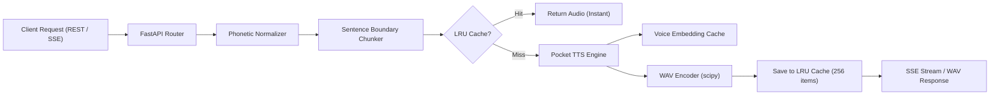

# 🎙️ Voices: FastAPI Neural TTS Server

A lightweight, local-first FastAPI neural text-to-speech bridge powered by **Pocket TTS**. Designed for real-time, low-latency audio generation with zero cloud or internet dependencies, serving both the **Voices Chrome Extension (MV3)** and the **Voices Windows Desktop Companion (WinUI 3)**.

---

## 🌟 Core Architecture & Capabilities



### 1. High-Fidelity Offline Neural Speech
Runs entirely on device using `pocket_tts`, ensuring absolute privacy, zero API costs, and deterministic latency without network dependency.

### 2. Sentence Boundary Chunking & Prosody
Intelligently divides long passages of text along natural punctuation and clause boundaries (`.`, `!`, `?`, `…`, `,`, `;`, `:`), preserving natural speech rhythm and introducing subtle silence transitions (120ms) between synthesized sentences.

### 3. High-Performance In-Memory LRU Caching
- **Audio Cache**: Maintains an `OrderedDict`-backed Least Recently Used (LRU) cache of up to 256 generated audio waveforms keyed by voice and SHA-256 text hash.
- **Voice State Cache**: Pre-warms and caches neural voice latents in memory for instant reuse across consecutive syntheses.
- **Cache Telemetry**: Full requests return `X-Cache: HIT` or `X-Cache: MISS` HTTP response headers.

### 4. Phonetic & Technical Normalization Engine
Raw text is pre-processed before synthesis through an intelligent phonetic transformer:
- **Currencies**: Converts `$100`, `€50`, `£25`, `¥1000` to spoken natural currency terms ("100 dollars", "50 euros", etc.).
- **Software Versions**: Transforms `v1.2` or `V2.0` to "version 1.2".
- **Programming Languages**: Normalizes `C#` ("C sharp"), `C++` ("C plus plus"), `.NET` ("dot net"), and `Node.js` ("Node dot J S").
- **Abbreviations**: Expands `e.g.` ("for example"), `i.e.` ("that is"), `etc.` ("etcetera"), `vs.` ("versus"), `approx.` ("approximately"), `Dr.`, `Mr.`, `Mrs.`, `Prof.`.
- **Measurements & Units**: Expands `km/h`, `mph`, `GB`, `MB`, `KB`, `TB`, `kHz`, `MHz`, `GHz`, `ms`, `fps`, `px`, `cm`, `mm`, `kg`.
- **Tech Acronyms**: Maps acronyms to natural phonetics (e.g. `TTS` -> "T T S", `SQL` -> "sequel", `JSON` -> "Jason", `GUI` -> "gooey", `URL` -> "U R L").
- **Spoken Math & Symbols**: Phonetically translates `/`, `\`, `+`, `=`, `%`, `&`, `@`, `#`, `_`, `|`, `~`, `*`.
- **Custom Dictionary**: User-trained pronunciations dynamically loaded and persisted in `pronunciation_dict.json`.

---

## 🎭 Available Voice Personas

Voices includes 8 built-in neural voice profiles:

| Voice Identifier | Persona Style | Recommended Use |
| :--- | :--- | :--- |
| **`alba`** *(default)* | Calm, warm, neutral narrator | Articles, long-form reading, documentation |
| **`fantine`** | Expressive, engaging, gentle | Creative writing, narratives |
| **`jean`** | Deep, authoritative, steady | Technical tutorials, news briefs |
| **`marius`** | Clear, energetic, conversational | Short snippets, interactive web reading |
| **`javert`** | Formal, firm, measured | Legal notices, structured summaries |
| **`cosette`** | Soft, melodic, bright | Casual blog posts, personal reading |
| **`eponine`** | Dynamic, upbeat, modern | Social feeds, messaging snippets |
| **`azelma`** | Crisp, balanced, versatile | Mixed prose, daily productivity |

---

## 🛠️ Setup & Installation

### Prerequisites
- **Python**: Version `3.10`, `3.11`, or `3.12` recommended.
- **Operating System**: Windows 10/11, macOS, or Linux.
- **Hardware**: Any modern multi-core x86_64 or ARM64 CPU. (Single-thread optimization flags are safely applied to eliminate BLAS memory collisions).

### Installation Steps

1. **Clone or navigate to the repository:**
   ```bash
   cd server
   ```

2. **(Optional but recommended) Create a virtual environment:**
   ```bash
   python -m venv .venv
   # Windows:
   .venv\Scripts\activate
   # macOS/Linux:
   source .venv/bin/activate
   ```

3. **Install dependencies:**
   ```bash
   pip install -r requirements.txt
   ```

---

## 🏃 Running the Server

### Method A: One-Click Startup (Windows)
Double-click `run.bat` in the `server/` directory, or execute it from the terminal:
```cmd
server\run.bat
```
*`run.bat` automatically tests for `python`, `py`, and `python3`, sets UTF-8 console output (`chcp 65001`), and launches the server.*

### Method B: Direct Python Execution
```bash
python server.py
```

### Method C: Uvicorn ASGI Runner
```bash
uvicorn server:app --host 127.0.0.1 --port 8000 --reload
```

### Configuration Environment Variables
| Variable | Default | Description |
| :--- | :--- | :--- |
| `VOICES_HOST` | `127.0.0.1` | Network interface to bind |
| `VOICES_PORT` | `8000` | Port to bind |
| `OPENBLAS_NUM_THREADS` | `1` | Enforced thread limit for OpenBLAS |
| `OMP_NUM_THREADS` | `1` | Enforced thread limit for OpenMP |

Once started, the server is available at `http://127.0.0.1:8000`.  
Interactive OpenAPI documentation (Swagger UI) is accessible at:
- **Swagger Docs**: `http://127.0.0.1:8000/docs`
- **ReDoc**: `http://127.0.0.1:8000/redoc`

---

## 📡 API Reference

### 1. Root Info & Status
- **Method:** `GET`
- **Path:** `/`
- **Description:** Basic service information and navigation endpoints.

**Response (`200 OK`):**
```json
{
  "service": "Voices - Local Neural TTS Bridge",
  "version": "1.1.0",
  "status": "ready",
  "docs_url": "/docs",
  "health_url": "/health"
}
```

---

### 2. Health & Telemetry
- **Method:** `GET`
- **Path:** `/health`
- **Description:** Verifies server health, neural model readiness, in-memory cache capacity, and trained phonetic vocabulary size.

**Response (`200 OK`):**
```json
{
  "status": "ok",
  "version": "1.1.0",
  "model_loaded": true,
  "model_error": null,
  "cached_voices": ["alba"],
  "response_cache_items": 42,
  "trained_complex_words": 150
}
```

---

### 3. Generate Audio (Direct WAV)
- **Method:** `POST`
- **Path:** `/tts`
- **Content-Type:** `application/json`
- **Description:** Synthesizes the requested text in one batch and returns binary `audio/wav` bytes.

**Request Body:**
```json
{
  "text": "Voices converts written text into lifelike neural speech in real-time.",
  "voice": "alba"
}
```

**Response (`200 OK`):**
- **Content-Type**: `audio/wav`
- **Headers**:
  - `X-Cache: HIT` (served instantly from LRU cache)
  - `X-Cache: MISS` (synthesized fresh by the neural model)

**Example `curl`:**
```bash
curl -X POST "http://127.0.0.1:8000/tts" \
     -H "Content-Type: application/json" \
     -d "{\"text\": \"Hello from Voices neural TTS!\", \"voice\": \"alba\"}" \
     --output output.wav
```

---

### 4. Low-Latency Streaming (Server-Sent Events)
- **Method:** `POST`
- **Path:** `/tts/stream`
- **Content-Type:** `application/json`
- **Description:** Chunks text into conversational sentences and yields each sentence's synthesized WAV audio as a Base64 string in real time via Server-Sent Events (`text/event-stream`).

**Request Body:**
```json
{
  "text": "First sentence is synthesized immediately. The second sentence streams right after without waiting for full completion.",
  "voice": "alba"
}
```

**SSE Stream Output:**
```text
data: {"index": 0, "total": 2, "text": "First sentence is synthesized immediately.", "audio": "UklGRi...", "cached": false}

data: {"index": 1, "total": 2, "text": "The second sentence streams right after without waiting for full completion.", "audio": "UklGRi...", "cached": false}

data: {"event": "done", "total": 2}
```

---

### 5. Get Pronunciation Vocabulary
- **Method:** `GET`
- **Path:** `/pronunciation`
- **Description:** Lists all registered custom phonetic pronunciation overrides.

**Response (`200 OK`):**
```json
{
  "total": 3,
  "words": {
    "kubernetes": "koo-ber-net-ees",
    "postgresql": "post-gres-Q-L",
    "scikit-learn": "sigh-kit learn"
  }
}
```

---

### 6. Train Pronunciation Override
- **Method:** `POST`
- **Path:** `/pronunciation`
- **Content-Type:** `application/json`
- **Description:** Registers a custom phonetic respelling for difficult, technical, or non-English terms and persists it to `server/pronunciation_dict.json`.

**Request Body:**
```json
{
  "word": "FastAPI",
  "pronunciation": "Fast A P I"
}
```

**Response (`200 OK`):**
```json
{
  "status": "ok",
  "word": "fastapi",
  "pronunciation": "Fast A P I",
  "total_trained": 4
}
```

---

## 📁 Server Directory Structure

```text
server/
├── server.py               # FastAPI server application & inference pipeline
├── run.bat                 # Windows one-click startup launcher
├── requirements.txt        # Python backend dependencies
├── pronunciation_dict.json # Saved custom phonetic vocabulary mappings
├── generate_icons.py       # Helper script for building multi-res extension icons
└── README.md               # Backend documentation (this file)
```
